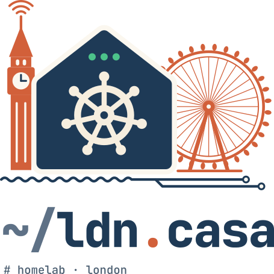
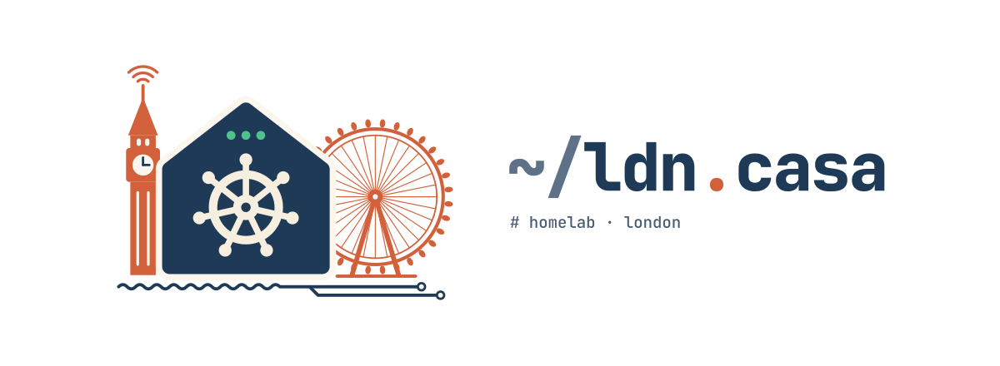

# ldn.casa branding

London landmarks, a homelab, and a little movement. This repository contains the existing **ldn.casa** logos in light and dark palettes, with stacked and horizontal layouts, static vector artwork, transparent PNG exports, and animated SVGs.

<picture>
  <source media="(prefers-color-scheme: dark)" srcset="assets/static/svg/ldn-casa-horizontal-dark.svg">
  <source media="(prefers-color-scheme: light)" srcset="assets/static/svg/ldn-casa-horizontal-light.svg">
  
</picture>

## Choose an asset

| Use | Recommended asset |
| --- | --- |
| README header or wide website header | Horizontal SVG; static for predictable rendering |
| Square placement, profile artwork, or a compact brand panel | Stacked SVG, or a stacked PNG if SVG is unsupported |
| Website with subtle motion | Animated SVG, tested in its final embedding context |
| Slides, documents, or services that reject SVG | PNG at an appropriate pixel size |
| Light background | `light` palette: navy lettering and terracotta accents |
| Dark background | `dark` palette: cream lettering and warm orange accents |

`light` and `dark` describe the **intended surrounding background**, not an opaque background baked into the logo. The PNG exports have transparency, and the SVG artwork has no full-canvas background. Filled shapes inside the illustration are intentional. A checkerboard in Illustrator is a transparency display aid, not part of the artwork.

The stacked layout includes the wordmark and tagline; it is not a standalone icon. Check legibility at the final display size before using it as an avatar or favicon. No dedicated favicon, icon-only mark, or editable Illustrator source is included.

## Asset catalogue

```text
assets/
├── animated/
│   └── svg/              # 4 animated SVGs: two layouts × two palettes
└── static/
    ├── svg/              # 4 static SVGs: two layouts × two palettes
    └── png/              # 12 PNGs: two layouts × two palettes × three sizes
docs/
└── asset-map.csv          # Original names, current paths, and SHA-256 checksums
```

### SVGs

| Layout and palette | Static SVG | Animated SVG |
| --- | --- | --- |
| Stacked, light | [Static](assets/static/svg/ldn-casa-stacked-light.svg) | [Animated](assets/animated/svg/ldn-casa-stacked-light.svg) |
| Stacked, dark | [Static](assets/static/svg/ldn-casa-stacked-dark.svg) | [Animated](assets/animated/svg/ldn-casa-stacked-dark.svg) |
| Horizontal, light | [Static](assets/static/svg/ldn-casa-horizontal-light.svg) | [Animated](assets/animated/svg/ldn-casa-horizontal-light.svg) |
| Horizontal, dark | [Static](assets/static/svg/ldn-casa-horizontal-dark.svg) | [Animated](assets/animated/svg/ldn-casa-horizontal-dark.svg) |

Static SVG viewBoxes are `455.3 × 455.01` (stacked) and `920.83 × 282.28` (horizontal). Animated SVG canvases are `720 × 720` (stacked) and `1200 × 440` (horizontal). Static and animated versions have different framing and aspect ratios: review spacing when swapping them rather than assuming they are interchangeable crops.

### PNGs

The size suffix records the original export scale, not a recommended CSS size. Dimensions below are the actual file dimensions, including the original export rounding.

| Layout | Export | Dimensions | Light | Dark |
| --- | --- | --- | --- | --- |
| Stacked | `1x` | 456 × 456 px | [PNG](assets/static/png/ldn-casa-stacked-light-1x.png) | [PNG](assets/static/png/ldn-casa-stacked-dark-1x.png) |
| Stacked | `0.75x` | 342 × 342 px | [PNG](assets/static/png/ldn-casa-stacked-light-0.75x.png) | [PNG](assets/static/png/ldn-casa-stacked-dark-0.75x.png) |
| Stacked | `0.5x` | 228 × 228 px | [PNG](assets/static/png/ldn-casa-stacked-light-0.5x.png) | [PNG](assets/static/png/ldn-casa-stacked-dark-0.5x.png) |
| Horizontal | `1x` | 922 × 283 px | [PNG](assets/static/png/ldn-casa-horizontal-light-1x.png) | [PNG](assets/static/png/ldn-casa-horizontal-dark-1x.png) |
| Horizontal | `0.75x` | 691 × 212 px | [PNG](assets/static/png/ldn-casa-horizontal-light-0.75x.png) | [PNG](assets/static/png/ldn-casa-horizontal-dark-0.75x.png) |
| Horizontal | `0.5x` | 461 × 142 px | [PNG](assets/static/png/ldn-casa-horizontal-light-0.5x.png) | [PNG](assets/static/png/ldn-casa-horizontal-dark-0.5x.png) |

## Embed in a GitHub README

### Within this repository

Use relative paths from the Markdown file. These examples assume the README is at the repository root; adjust the path for a README in a subdirectory. GitHub recommends relative paths for repository images in its [formatting guide](https://docs.github.com/en/get-started/writing-on-github/getting-started-with-writing-and-formatting-on-github/basic-writing-and-formatting-syntax#images).

```markdown

```

Use an HTML image when you want to control its displayed width. Set only the width so the aspect ratio is preserved:

```html

```

### Automatically select light or dark artwork

Use a `<picture>` element with explicit light and dark sources and a fallback ``, following [GitHub's theme-aware image example](https://docs.github.com/en/get-started/writing-on-github/getting-started-with-writing-and-formatting-on-github/quickstart-for-writing-on-github). Prefer this to the older `#gh-dark-mode-only` / `#gh-light-mode-only` fragments.

```html
<picture>
  <source media="(prefers-color-scheme: dark)"
          srcset="assets/static/svg/ldn-casa-horizontal-dark.svg">
  <source media="(prefers-color-scheme: light)"
          srcset="assets/static/svg/ldn-casa-horizontal-light.svg">
  
</picture>
```

### From another repository

Use absolute raw-content URLs when embedding these assets in another repository. This animated example selects the matching palette and uses light artwork as the fallback:

```html
<picture>
  <source media="(prefers-color-scheme: dark)"
          srcset="https://raw.githubusercontent.com/ohheyrj/ldn-casa-branding/main/assets/animated/svg/ldn-casa-horizontal-dark.svg">
  <source media="(prefers-color-scheme: light)"
          srcset="https://raw.githubusercontent.com/ohheyrj/ldn-casa-branding/main/assets/animated/svg/ldn-casa-horizontal-light.svg">
  
</picture>
```

For a static equivalent, change all three `/animated/svg/` segments to `/static/svg/`. For a plain Markdown embed:

```markdown

```

## Raw URLs and versioning

Copy-ready examples:

| Asset | Raw URL |
| --- | --- |
| Static horizontal, light | [Raw SVG](https://raw.githubusercontent.com/ohheyrj/ldn-casa-branding/main/assets/static/svg/ldn-casa-horizontal-light.svg) |
| Static horizontal, dark | [Raw SVG](https://raw.githubusercontent.com/ohheyrj/ldn-casa-branding/main/assets/static/svg/ldn-casa-horizontal-dark.svg) |
| Animated horizontal, light | [Raw SVG](https://raw.githubusercontent.com/ohheyrj/ldn-casa-branding/main/assets/animated/svg/ldn-casa-horizontal-light.svg) |
| Animated horizontal, dark | [Raw SVG](https://raw.githubusercontent.com/ohheyrj/ldn-casa-branding/main/assets/animated/svg/ldn-casa-horizontal-dark.svg) |
| Static stacked PNG, light, 1x | [Raw PNG](https://raw.githubusercontent.com/ohheyrj/ldn-casa-branding/main/assets/static/png/ldn-casa-stacked-light-1x.png) |
| Static stacked PNG, dark, 1x | [Raw PNG](https://raw.githubusercontent.com/ohheyrj/ldn-casa-branding/main/assets/static/png/ldn-casa-stacked-dark-1x.png) |

These URLs target the configured `ohheyrj/ldn-casa-branding` remote and the local `main` branch. They become available only after the files are committed and pushed to that branch on GitHub, with access appropriate to the repository's visibility. Local path verification does not establish that a URL is already published. Cross-repository embeds also require the viewer to have access; private raw URLs are not a dependable public asset host. Never put access tokens in README image URLs.

A `main` URL follows future updates. For a reproducible reference, replace `main` with the full commit SHA containing the asset after publication. Use raw-content URLs for embeds, rather than GitHub `/blob/` page URLs. GitHub and browser caches can delay visible changes; check the file and its selected theme before assuming an export is wrong.

## Animation and compatibility

The four animated SVGs are self-contained: embedded CSS rotates the London Eye once every **40 seconds** and pulses the Wi-Fi arcs on a **2.2-second** loop, with **0.25-second** and **0.5-second** delays. There is no JavaScript, external font, or linked image dependency. The supplied `prefers-reduced-motion: reduce` rule disables both effects in supporting viewers.

- Embed an SVG as an image (``, Markdown image, or `<picture>` source). Pasting SVG markup and a `<style>` block into a GitHub README is not a substitute for linking the file.
- Rendering varies by viewer and delivery pipeline. A thumbnail, editor preview, document export, or image proxy may show a still image or remove unsupported features. Test the final README on GitHub and the final website in the browsers you support; preserved SVG source does not guarantee animation in every host.
- A static-looking result can be expected when reduced motion is enabled. Confirm that the animated file is selected and allow time for the slow rotation before diagnosing a failure.
- A `<picture>` fallback handles source selection; it is **not** an animation-support detector. It will not automatically swap in a static asset merely because CSS animation is unavailable.
- PNGs are still images. Exporting an animated SVG as PNG does not preserve movement. Use the supplied static exports when motion is unnecessary or unsupported.
- Keep the original animated SVG as the master. Opening and saving through Illustrator, flattening, or applying an SVG optimiser can remove `<style>`, keyframes, classes, transform behaviour, or accessibility metadata. Work on a copy and compare the result before replacing an asset.
- Preserve `.ldn-eye`, `.ldn-wifi`, `.ldn-wifi2`, `.ldn-wifi3`, `transform-box`, `transform-origin`, keyframes, and the reduced-motion media query. When building a website, image embedding also keeps each SVG's internal styling separate from page styles.

## Asset guidance

- Keep proportions intact. Do not stretch, crop away the wordmark or landmarks, or recolour individual elements without creating a deliberate new variant.
- Choose the palette for the actual surface behind the image. A dark logo on a light page can make cream lettering disappear; transparency does not automatically switch its colours.
- Leave breathing room around the complete artwork and check the tagline at its final size. No formal minimum size or clear-space specification has been supplied.
- Prefer SVG for scalable web use. For PNG, choose enough pixels for the display density: a 456 px image supports a roughly 228 CSS px placement at 2× density. Avoid enlarging a small PNG to fill a large header.
- Keep a useful `alt` description. Where an adjacent heading already repeats the same identity and the image is purely decorative, use `alt=""` instead.
- Preserve transparency when exporting. Do not add a white or dark rectangle solely to hide the editor's checkerboard.

## Provenance and maintenance

All **20 supplied branding files** were moved and renamed without changing their bytes. [The asset map](docs/asset-map.csv) records every original path, new path, and SHA-256 checksum. Artboards 1 and 2 are the light and dark stacked logos; artboards 3 and 4 are the light and dark horizontal logos. The original animated `long` files are named `horizontal` here, and the `_1` export suffix has been removed.

Finder `.DS_Store` metadata is ignored by Git and retained locally; old export directories may remain locally because they contain that metadata. It is not branding artwork. No existing export was discarded or regenerated.

For future updates, retain the same layout and palette naming, add deliberate new variants rather than overwriting unrelated exports, and test static appearance, transparency, theme selection, motion, and reduced motion in the intended host. Update the asset map and catalogue if filenames or dimensions change. Checksums describe this organisation baseline; refresh them when intentionally replacing asset contents.

No licence or usage grant was supplied with these assets. This README documents their use and does not assign new reuse rights.
